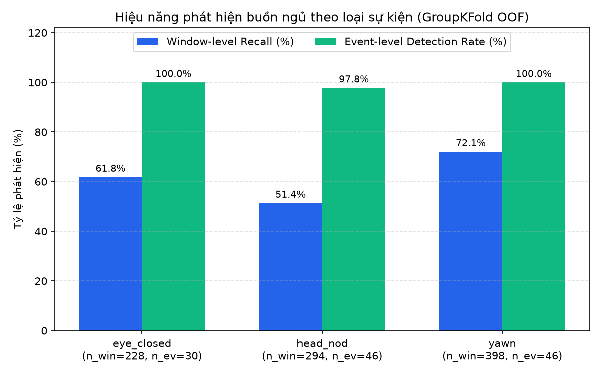

# 03. Đánh Giá Mô Hình, Tinh Chỉnh Ngưỡng & Phân Tích Sự Kiện (Evaluation & Error Analysis)

> [!NOTE]
> **Mục tiêu của nhóm module:** Đánh giá khách quan khả năng tổng quát hóa của mô hình trên người lái chưa từng gặp (`GroupKFold`), tối ưu ngưỡng phân loại cho ứng dụng thực tế và phân tích lỗi chuyên sâu theo từng nhóm hành vi buồn ngủ (`eye_closed`, `head_nod`, `yawn`).

## 1. Danh sách file thuộc nhóm

| Đường dẫn | Vai trò chính | Đầu ra / Biểu đồ |
| :--- | :--- | :--- |
| `ai/evaluate.py` | Tính Precision, Recall, F1-score; đối chiếu Random Forest với Baseline. | `docs/figures/confusion_matrix.png`, `docs/figures/feature_importance.png` |
| `ai/cross_validate.py` | Kiểm chứng chéo `GroupKFold` chia theo `subject_id` tránh data leakage. | Bảng điểm đánh giá trung bình qua các fold không trùng người |
| `ai/tune_threshold.py` | Quét ngưỡng xác suất `threshold` cân bằng giữa bỏ sót buồn ngủ và báo động giả. | `docs/figures/pr_curve.png`, đề xuất ngưỡng tối ưu cho `app/app_config.py` |
| `ai/analyze_events.py` | Ghép `train_features.csv` + `annotations_train.csv`, đánh giá OOF riêng cho `eye_closed`, `head_nod`, `yawn`. | Bảng thống kê 9 cột và biểu đồ `docs/figures/event_analysis.png` |
| `test/test_event_analysis.py` | Bộ 5 unit test cho đọc annotation, alias `video_name`, gán sự kiện theo frame, cắt cửa sổ và tính metric. | Pass 100% độc lập dữ liệu thật |

---

## 2. Phân tích chi tiết luồng xử lý `ai/analyze_events.py`

Pipeline phân tích sự kiện hoạt động theo 5 bước tuần tự:

1. **`load_features_csv(path)` & `load_annotations_csv(path)`:**
   * Tự động nhận diện và chuẩn hóa các tên cột thực tế của tập dữ liệu (`video_name` $\rightarrow$ `video_id`, `behavior` $\rightarrow$ `event_type`).
   * Hỗ trợ đọc annotation ở cả định dạng chỉ số khung (`start_frame`/`end_frame`) lẫn định dạng giây (`start_sec`/`end_sec` nhân `fps`).
2. **`assign_frame_events(df, annotations)`:**
   * Ánh xạ từng khoảng `[start_frame, end_frame]` theo đúng `video_id` để gắn `event_type` và `event_id` cho từng khung hình; khung ngoài sự kiện mang nhãn `"normal"` (`event_id = -1`).
3. **`build_event_windows(df_with_events, window_size=30, stride=10)`:**
   * Cắt cửa sổ trượt theo từng video (không vắt ngang video), tính 9 đặc trưng bằng `build_window_features()` và ghi nhận `event_type` chiếm ưu thế cùng `event_id` tương ứng vào `meta_df`.
4. **`get_oof_probabilities(X, y, groups)`:**
   * Chạy `GroupKFold` (tối đa 5 fold theo `subject_id`) với `RandomForestClassifier(n_estimators=200, random_state=42, class_weight="balanced")` để thu xác suất dự đoán Out-of-Fold hoàn toàn không rò rỉ dữ liệu.
5. **`compute_event_metrics(...)` & `plot_event_analysis(...)`:**
   * Tính đồng thời 2 cấp độ đánh giá và xuất biểu đồ cột so sánh `docs/figures/event_analysis.png`:
     * **Window-level Recall:** Tỷ lệ cửa sổ thuộc sự kiện được mô hình dự đoán là buồn ngủ (`y_pred = 1`).
     * **Event-level Detection Rate:** Tỷ lệ sự kiện thực tế được phát hiện thành công ở ít nhất 1 cửa sổ trong suốt thời gian diễn ra sự kiện.

---

## 3. Kết quả thực nghiệm theo loại sự kiện (OOF GroupKFold, `threshold = 0.50`)

Lệnh chạy:
```powershell
python -m ai.analyze_events
```

| Loại sự kiện | Số cửa sổ (`n_windows`) | Số sự kiện (`n_events`) | Window Recall | Event Detection Rate | Xác suất TB (`mean_proba`) | EAR TB | MAR TB | PERCLOS TB |
| :--- | :---: | :---: | :---: | :---: | :---: | :---: | :---: | :---: |
| `eye_closed` | 228 | 30 | 61.8% | **100.0%** | 0.567 | 0.183 | 0.012 | 0.585 |
| `head_nod` | 294 | 46 | **51.4%** | **97.8%** | **0.478** | 0.211 | 0.014 | 0.496 |
| `yawn` | 398 | 46 | **72.1%** | **100.0%** | **0.651** | 0.234 | 0.456 | 0.267 |



### Nhận xét & Kiểm chứng giả thuyết `head_nod`

> [!WARNING]
> **Giả thuyết về `head_nod` được chứng minh rõ ràng:** `head_nod` đạt **Window Recall thấp nhất (51.4%)**, thấp hơn `eye_closed` $10.4$ điểm phần trăm và thấp hơn `yawn` $20.7$ điểm phần trăm; xác suất dự đoán trung bình chỉ là **0.478** (dưới ngưỡng `0.50`) và là nhóm duy nhất bỏ sót trọn vẹn 1 sự kiện (`45/46`, tức `97.8%`).

* **Nguyên nhân kỹ thuật ở `head_nod`:** Bộ đặc trưng 9 chiều hiện tại chỉ quan sát mắt và miệng (`EAR`, `MAR`, `PERCLOS`). Trong các cửa sổ gật đầu, miệng khép (`mean_mar = 0.014`) và `mean_ear = 0.211` vẫn nằm trên ngưỡng PERCLOS `0.20` (`mean_perclos = 0.496`). Mô hình chỉ nhận ra `head_nod` một cách *gián tiếp* khi người lái nhắm mắt kèm theo hoặc khi đầu cúi làm biến dạng hình chiếu 2D của mắt.
* **`yawn` đạt hiệu năng cao nhất:** Tín hiệu `mean_mar = 0.456` tách biệt rất mạnh (gấp hơn 30 lần mức `0.012`–`0.014` của hai nhóm còn lại), giúp đạt **Window Recall 72.1%** và **Event Detection Rate 100.0%**.
* **`eye_closed` ổn định:** `mean_ear` giảm sâu (`0.183`) và `mean_perclos` tăng cao (`0.585`), bắt trọn `30/30` sự kiện (`100.0%`).
* **Chênh lệch mức cửa sổ vs. mức sự kiện:** Mức sự kiện (`97.8%`–`100.0%`) cao hơn nhiều mức cửa sổ (`51.4%`–`72.1%`) do các cửa sổ rìa đầu/cuối sự kiện chỉ chứa một phần hành vi buồn ngủ. Tuy vậy, Window Recall thấp ở `head_nod` sẽ làm tăng độ trễ kích hoạt cảnh báo.

> [!TIP]
> **Hướng cải tiến có cơ sở định lượng:** File `train_features.csv` đã có sẵn các góc đầu (`yaw`, `roll`, ...). Bổ sung thống kê góc cúi đầu (`pitch`) và tốc độ biến thiên góc đầu vào `build_window_features()` là bước nâng cấp trực tiếp nhất để cải thiện Recall cho `head_nod`.

---

## 4. Kiểm thử đơn vị (`test/test_event_analysis.py`)

| Tên hàm test | Mục tiêu kiểm chứng |
| :--- | :--- |
| `test_load_annotations_csv_supports_frame_columns` | Đọc CSV annotation dạng frame, chuẩn hóa chữ thường `event_type` và giữ đúng `start_frame`/`end_frame`. |
| `test_assign_frame_events_maps_intervals` | Gán đúng loại sự kiện trong khoảng `[start_frame, end_frame]` và gán `"normal"` ngoài khoảng. |
| `test_build_event_windows_no_cross_video` | 2 video $\times$ 40 khung ($W=20, S=10$) tạo đúng 6 cửa sổ, khớp chiều `X, y, groups, meta`. |
| `test_compute_event_metrics_values_and_missing_event` | Kiểm tra độ chính xác số thực bằng `pytest.approx` và trả `NaN` khi loại sự kiện không xuất hiện (`n_windows = 0`). |
| `test_load_features_csv_accepts_video_name` | Đảm bảo đọc được file dùng cột `video_name` và tự ánh xạ sang `video_id`. |