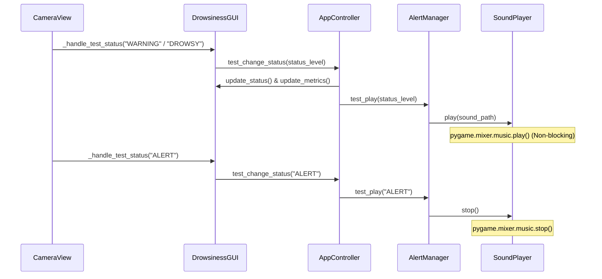
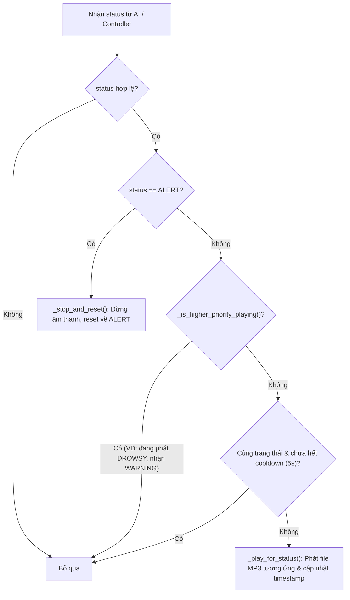

# BÁO CÁO NHIỆM VỤ (TASK REPORT): XÂY DỰNG ALERT MODULE VÀ TÍCH HỢP KIỂM THỬ ÂM THANH QUA GUI

---

## 1. Thông Tin Task

- **Tên Task**: Xây dựng Alert Module (`SoundPlayer`, `AlertManager`) và tích hợp kiểm thử âm thanh qua GUI
- **Người thực hiện**: Hoàng Tuấn Dũng
- **Branch**: `feature/camera-gui`
- **Pull Request**: [Link PR]
- **Dự án**: AI Drowsiness Detection System (Hệ thống giám sát và cảnh báo buồn ngủ tài xế)

---

## 2. Mục Tiêu Task

- **Xây dựng module phát âm thanh độc lập (`SoundPlayer`)**: Hỗ trợ phát các file MP3 có sẵn trong `assets/sound/` bằng `pygame.mixer`, đảm bảo không chặn (non-blocking) luồng chính của Tkinter/CustomTkinter, không khởi tạo mixer lặp lại và giải phóng tài nguyên an toàn.
- **Xây dựng bộ quản lý logic cảnh báo (`AlertManager`)**: Ánh xạ trạng thái tài xế (`ALERT`, `WARNING`, `DROWSY`) sang âm thanh tương ứng; chống phát lặp mất kiểm soát bằng cơ chế cooldown; ưu tiên mức độ nghiêm trọng (`DROWSY` > `WARNING`); và dừng âm thanh khi chuyển về `ALERT`.
- **Tích hợp kiểm thử âm thanh trực tiếp qua GUI**: Tận dụng 3 nút có sẵn (`Alert`, `Warn`, `Drowsy`) trên `CameraView` theo luồng `CameraView → GUI → Controller → AlertManager → SoundPlayer`, hoạt động độc lập kể cả khi camera chưa bật và không bị cooldown chặn khi nhấn test liên tục.
- **Chuẩn bị API cho tích hợp AI Predictor trong tương lai**: Cung cấp sẵn `self.alert_manager.handle_status(status_level)` để Controller gọi khi AI hoàn thiện, đồng thời đảm bảo vòng lặp camera hiện tại (kể cả cảnh báo "Không phát hiện khuôn mặt") không vô tình kích hoạt âm thanh buồn ngủ.
- **Dọn dẹp tài nguyên khi đóng ứng dụng**: Đảm bảo `AppController.on_closing()` dừng mọi âm thanh và gọi `cleanup()` để không để tiến trình/âm thanh chạy ngầm.
- **Kiểm thử tự động**: Viết bộ unit test trong `test/test_alert.py` kiểm tra đầy đủ ánh xạ, logic cooldown, độ ưu tiên và xử lý lỗi an toàn.

---

## 3. Các File Đã Tạo Hoặc Sửa

| STT | Đường dẫn file | Trạng thái | Trách nhiệm chính |
| :-: | :--- | :-: | :--- |
| 1 | `alert/sound.py` | Tạo mới | Triển khai lớp `SoundPlayer` sử dụng `pygame.mixer` và `threading.Lock` để phát, dừng, kiểm tra trạng thái và giải phóng tài nguyên âm thanh an toàn. |
| 2 | `alert/alert_manager.py` | Tạo mới | Triển khai lớp `AlertManager` quản lý ánh xạ trạng thái → file âm thanh, xử lý ưu tiên (`DROWSY` > `WARNING`), cooldown (`DEFAULT_COOLDOWN = 5.0`s) cho `handle_status()`, và `test_play()` cho GUI. |
| 3 | `alert/__init__.py` | Tạo mới | Khởi tạo package `alert`, xuất bản `AlertManager` và `SoundPlayer`. |
| 4 | `app/app_config.py` | Chỉnh sửa | Bổ sung `WARNING_SOUND_PATH` (`Alarm Sound Effect.mp3`) và `DROWSY_SOUND_PATH` (`Nhạc báo thức dậy đi ông cháu ơi.mp3`) dựa trên `SOUND_DIR` (`pathlib.Path`). |
| 5 | `app/controller.py` | Chỉnh sửa | Import và khởi tạo `self.alert_manager = AlertManager()`; tích hợp `self.alert_manager.test_play(status_level)` vào `test_change_status()`; gọi `self.alert_manager.cleanup()` trong `on_closing()`. |
| 6 | `test/test_alert.py` | Tạo mới | Bộ 20 unit tests (`unittest`) kiểm tra ánh xạ file âm thanh, logic `handle_status()`, cooldown, ưu tiên `DROWSY` > `WARNING`, `test_play()`, và xử lý an toàn khi thiếu file. |

---

## 4. Chức Năng Đã Hoàn Thiện

1. **Phát & Quản lý âm thanh cảnh báo (`SoundPlayer`)**:
   - Hỗ trợ phát các định dạng MP3/WAV qua `pygame.mixer.music` mà không làm treo giao diện CustomTkinter.
   - Dừng âm thanh cũ trước khi phát âm thanh mới, xử lý an toàn khi file không tồn tại hoặc mixer gặp lỗi.
   - Khởi tạo `pygame.mixer` duy nhất một lần và giải phóng hoàn toàn qua `cleanup()`.

2. **Quản lý logic cảnh báo thông minh (`AlertManager`)**:
   - **Ánh xạ trạng thái**:
     - `ALERT`: Không phát âm thanh; dừng âm thanh đang phát (nếu có) và reset trạng thái.
     - `WARNING`: Phát `Alarm Sound Effect.mp3`.
     - `DROWSY`: Phát `Nhạc báo thức dậy đi ông cháu ơi.mp3`.
   - **Chống spam âm thanh (Cooldown)**: Khi nhận trạng thái từ AI qua `handle_status()`, nếu cùng trạng thái lặp lại trong vòng `5.0` giây (`DEFAULT_COOLDOWN`), âm thanh sẽ không bị phát chồng liên tục.
   - **Ưu tiên mức độ nghiêm trọng**: `DROWSY` (mức 2) > `WARNING` (mức 1) > `ALERT` (mức 0). Nếu đang phát âm thanh `DROWSY`, tín hiệu `WARNING` gửi tới sẽ không ghi đè; ngược lại `WARNING` có thể được nâng cấp lên `DROWSY`.

3. **Kiểm thử âm thanh trực tiếp qua GUI (Demo Test Mode)**:
   - Tận dụng 3 nút `🟢 Alert`, `⚠️ Warn`, `🚨 Drowsy` sẵn có trên `CameraView`.
   - Hoạt động bình thường ngay cả khi chưa bật camera.
   - Sử dụng `test_play()` bỏ qua cooldown để người dùng có thể bấm kiểm tra nhiều lần liên tiếp hoặc chuyển qua lại giữa `DROWSY` và `WARNING` tự do.

4. **Tách biệt với vòng lặp Camera & Đóng ứng dụng an toàn**:
   - Cảnh báo `WARNING` do `process_frame()` phát sinh khi không tìm thấy khuôn mặt chỉ hiển thị lên GUI, không kích hoạt âm thanh cảnh báo buồn ngủ.
   - Khi nhấn `[X]` đóng cửa sổ, `AppController.on_closing()` dừng camera, dừng âm thanh và gọi `alert_manager.cleanup()`.

---

## 5. Nguyên Lý Hoạt Động

### 5.1. Luồng Xử Lý Kiểm Thử Âm Thanh Từ GUI



### 5.2. Luồng Logic Của `AlertManager.handle_status(status)` (Chuẩn Bị Cho AI)



---

## 6. Cách Sử Dụng

### 6.1. Kiểm thử âm thanh thủ công qua GUI

1. Mở terminal tại thư mục gốc của dự án và chạy ứng dụng:
   ```bash
   python main.py
   ```
2. Không cần nhấn bật camera.
3. Nhấn các nút ở mục **Test nhanh:** bên dưới khung camera:
   - Nhấn **`⚠️ Warn`**: Giao diện chuyển trạng thái `WARNING`, phát âm thanh `Alarm Sound Effect.mp3`.
   - Nhấn **`🚨 Drowsy`**: Giao diện chuyển trạng thái `DROWSY`, phát âm thanh `Nhạc báo thức dậy đi ông cháu ơi.mp3`.
   - Nhấn **`🟢 Alert`**: Giao diện chuyển trạng thái `ALERT`, dừng ngay âm thanh đang phát.
   - Nhấn lặp lại **`⚠️ Warn`** hoặc **`🚨 Drowsy`** liên tục để kiểm tra khả năng phát lại không bị chặn bởi cooldown.
4. Nhấn nút **`[X]`** để đóng ứng dụng và xác nhận âm thanh dừng hẳn, chương trình thoát sạch.

### 6.2. Chạy Unit Tests tự động

```bash
python -m unittest discover -s test -p "test_alert.py" -v
```
Kết quả mong đợi: `Ran 20 tests ... OK` (sử dụng `MockSoundPlayer` để test độc lập không phụ thuộc phần cứng âm thanh).

### 6.3. Tích hợp với AI Predictor trong tương lai

Khi module AI Predictor sẵn sàng, `AppController` chỉ cần truyền trạng thái dự đoán vào `AlertManager`:
```python
self.alert_manager.handle_status(predicted_status)
```

---

## 7. Kiến Thức Áp Dụng

- **Thiết kế hướng mô-đun & Tách biệt trách nhiệm (Separation of Concerns / MVC)**: Tách `SoundPlayer` (tầng giao tiếp phần cứng/thư viện âm thanh), `AlertManager` (tầng nghiệp vụ cảnh báo: cooldown, độ ưu tiên, ánh xạ) và `AppController` (tầng điều phối GUI). Nhờ đó có thể mock `SoundPlayer` để unit test logic `AlertManager` hoàn toàn độc lập.
- **Lập trình bất đồng bộ với GUI (Non-blocking Audio Playback)**: Sử dụng `pygame.mixer.music` (chạy trên luồng nền của SDL) kết hợp `threading.Lock` để đảm bảo thao tác phát/dừng âm thanh an toàn giữa các luồng (thread-safe) và không làm đơ vòng lặp sự kiện `mainloop()` của Tkinter.
- **Cơ chế Anti-Spam (Cooldown) & Priority State Machine**: Sử dụng mốc thời gian (`time.time()`) để giới hạn tần suất phát lại cùng một cảnh báo khi AI gửi kết quả theo từng frame, đồng thời dùng bảng mức độ nghiêm trọng (`_SEVERITY_ORDER`) để đảm bảo cảnh báo khẩn cấp (`DROWSY`) không bị ghi đè bởi cảnh báo nhẹ hơn (`WARNING`).
- **Quản lý đường dẫn độc lập hệ điều hành**: Dùng `pathlib.Path` kết hợp các hằng số cấu hình trong `app/app_config.py` giúp ứng dụng chạy ổn định khi khởi chạy từ thư mục gốc dự án.
