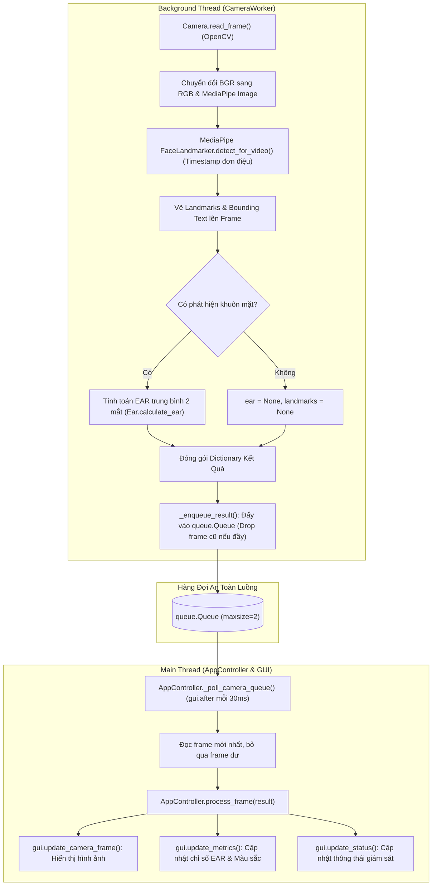

# BÁO CÁO NHIỆM VỤ (TASK REPORT): TRIỂN KHAI CAMERA WORKER VÀ TÍCH HỢP CAMERA/DETECTION VỚI GUI

---

## 1. Thông Tin Task

- **Tên Task**: Triển khai `CameraWorker` và tích hợp Camera / Detection với GUI + AppController
- **Người thực hiện**: Hoàng Tuấn Dũng
- **Nhánh (Branch)**: `feature/camera-gui`
- **Dự án**: AI Drowsiness Detection System (Hệ thống giám sát và cảnh báo buồn ngủ tài xế)

---

## 2. Mục Tiêu Task

- **Không làm nghẽn giao diện (Non-blocking Main Thread)**: Tách toàn bộ tác vụ đọc camera, xử lý hình ảnh và chạy thuật toán nhận diện khuôn mặt sang Background Thread độc lập, tránh hiện tượng giao diện CustomTkinter bị đơ (freeze / not responding).
- **Mô hình giao tiếp an toàn (Thread-Safe Communication)**: Tuân thủ nghiêm ngặt nguyên tắc của Tkinter: _Không cập nhật trực tiếp widget từ thread phụ_. Dữ liệu được trung chuyển qua `queue.Queue` và Controller polling trên Main Thread bằng `after()`.
- **Không dùng `cv.imshow()`**: Hiển thị hình ảnh camera trực tiếp trên widget `CameraView` của GUI thông qua chuyển đổi BGR sang PIL Image và `CTkImage`.
- **Quản lý vòng đời (Lifecycle Management)**: Cho phép người dùng bật/tắt camera nhiều lần liên tục mà không gây rò rỉ bộ nhớ (memory leak), không chiếm giữ camera khi tắt hoặc đóng ứng dụng.
- **Giải phóng tài nguyên triệt để (Resource Cleanup)**: Đảm bảo giải phóng `cv.VideoCapture` và đóng `MediaPipe FaceLandmarker` đúng cách trong mọi tình huống (kể cả khi gặp exception bất ngờ).
- **Tránh trễ khung hình (Zero Frame Accumulation)**: Giới hạn dung lượng Queue (`maxsize=2`), chủ động loại bỏ khung hình cũ khi queue đầy để đảm bảo GUI luôn hiển thị khung hình mới nhất theo thời gian thực.
- **Tương thích và mở rộng (Extensible Architecture)**: Tích hợp chuẩn xác với các module `Camera`, `Face_Detector`, `Ear` hiện có; chuẩn bị sẵn cấu trúc dữ liệu kết quả để dễ dàng tích hợp module AI (Random Forest) trong tương lai mà không cần sửa đổi CameraWorker hay GUI.

---

## 3. Các File Đã Tạo Hoặc Sửa

| STT | Đường dẫn file                 | Trạng thái | Trách nhiệm chính                                                                                                                                                                                       |
| :-: | :----------------------------- | :--------: | :------------------------------------------------------------------------------------------------------------------------------------------------------------------------------------------------------ |
|  1  | `app/workers/__init__.py`      | Chỉnh sửa  | Khởi tạo package `app.workers`, xuất bản lớp `CameraWorker` dùng chung.                                                                                                                                 |
|  2  | `app/workers/camera_worker.py` |  Tạo mới   | Triển khai lớp `CameraWorker`: quản lý thread phụ, đọc frame, chạy Face Detection (MediaPipe), trích xuất đặc trưng mắt (EAR), xử lý timestamp đơn điệu và đẩy kết quả vào Queue.                       |
|  3  | `app/controller.py`            | Chỉnh sửa  | Thay thế cơ chế camera giả lập (mock); khởi tạo và điều phối `CameraWorker`, polling kết quả từ Queue bằng `gui.after(30ms)`, cập nhật frame, chỉ số EAR, trạng thái lên GUI và xử lý shutdown an toàn. |
|  4  | `test_integration.py`          |  Tạo mới   | Kịch bản kiểm thử tích hợp tự động (headless): kiểm tra import, vòng đời start/stop, cơ chế hàng đợi drop frame, xử lý camera lỗi, kiểm tra API của `detection/`.                                       |

---

## 4. Chức Năng Đã Hoàn Thiện

1. **Xử lý Camera & Face Detection trên luồng ngầm (Background Thread Processing)**:
   - Camera chạy mượt mà ở tốc độ xấp xỉ 30 FPS trên một Daemon Thread riêng biệt.
   - Giao diện người dùng (nút bấm, đồng hồ, switch Dark/Light mode) phản hồi tức thì, hoàn toàn không bị ảnh hưởng bởi độ trễ tính toán của MediaPipe.

2. **Nhận diện khuôn mặt & Trích xuất đặc trưng (MediaPipe Face Landmarker & EAR)**:
   - Phát hiện khuôn mặt trong thời gian thực, tự động vẽ các điểm mốc (landmarks) lên khung hình.
   - Hiển thị nhãn cảnh báo trực quan trên frame: `Face Detected` (màu xanh lá) khi có mặt hoặc `No Face Detected` (màu đỏ) khi không tìm thấy mặt.
   - Tự động tính toán chỉ số Eye Aspect Ratio (EAR) trung bình của hai mắt khi có khuôn mặt; trả về `None` khi không có khuôn mặt (không dùng giá trị giả mạo).

3. **Cơ chế Hàng đợi Chống Trễ (Latency-Free Queue Handling)**:
   - Queue được thiết lập kích thước tối đa `maxsize = 2`.
   - Khi tốc độ xử lý của Controller hoặc GUI chậm hơn tốc độ sinh frame của Camera, frame cũ nhất sẽ tự động bị loại bỏ (drop frame), ưu tiên frame mới nhất để giữ luồng hình ảnh luôn đồng bộ thời gian thực.

4. **Tích hợp giao diện và đổi màu chỉ số thông minh**:
   - Khi có khuôn mặt: Cập nhật frame lên `CameraView`, hiển thị giá trị EAR trên `MetricsPanel`. Chỉ số EAR tự động chuyển màu đỏ (`#ef4444`) nếu thấp hơn ngưỡng cảnh báo `EAR_THRESHOLD` (0.25) hoặc màu xanh ngọc (`#10b981`) nếu mắt mở bình thường.
   - Khi không có khuôn mặt: Cập nhật trạng thái `WARNING` với thông báo _"Không phát hiện khuôn mặt"_ để nhắc nhở tài xế.

5. **Bật/Tắt linh hoạt & Tự động phục hồi lỗi (Fault Tolerance)**:
   - Người dùng có thể nhấn `▶ BẬT CAMERA` $\rightarrow$ `⏹ TẮT CAMERA` nhiều lần liên tục.
   - Nếu camera hỏng hoặc camera index không tồn tại, worker sẽ gửi thông báo lỗi qua Queue về Controller để hiển thị thông báo lên GUI và dừng an toàn, không làm crash chương trình.

6. **Đóng ứng dụng an toàn (Graceful Shutdown)**:
   - Bắt sự kiện người dùng bấm nút `[X]` (`WM_DELETE_WINDOW`): Controller tự động hủy callback `after()` đang chờ, ra hiệu dừng worker thread và giải phóng toàn bộ tài nguyên trước khi hủy cửa sổ Tkinter.

---

## 5. Nguyên Lý Hoạt Động

### 5.1. Sơ đồ Luồng Dữ Liệu (Data Flow)



### 5.2. Chi Tiết Các Cơ Chế Kỹ Thuật

#### a. Mô hình Producer - Consumer phi khóa

- **Producer (CameraWorker)**: Chạy vòng lặp vô hạn `_worker_loop` trên background thread, liên tục sản xuất các dictionary kết quả và gọi `_enqueue_result()`.
- **Consumer (AppController)**: Chạy trên Main Thread, sử dụng vòng lặp đồng hồ của GUI thông qua `gui.after(30, self._poll_camera_queue)` để tiêu thụ kết quả.

#### b. Xử lý Timestamp đơn điệu cho MediaPipe Video Mode

- `MediaPipe FaceLandmarker` khi cấu hình `RunningMode.VIDEO` yêu cầu timestamp truyền vào method `detect_for_video(image, timestamp_ms)` phải luôn **tăng đơn điệu thực sự**.
- Nếu sử dụng `int(time.time() * 1000)`, trong các vòng lặp cực nhanh có thể xuất hiện 2 frame cùng một millisecond, gây ra exception nghiêm trọng của MediaPipe C++ backend.
- **Giải pháp**: CameraWorker tự quản lý biến `self._timestamp_ms` với bước nhảy tăng dần đều (`+= 33` ms tương đương ~30 FPS), đảm bảo MediaPipe hoạt động ổn định 100%.

#### c. Cấu trúc dữ liệu chuẩn qua Queue

Mỗi phần tử được đưa vào Queue có cấu trúc dictionary đồng nhất:

```python
# Khi phát hiện khuôn mặt:
{
    "frame": <numpy.ndarray BGR>,
    "has_face": True,
    "landmarks": <NormalizedLandmarkList>,
    "ear": 0.285,
    "error": None
}

# Khi không có khuôn mặt:
{
    "frame": <numpy.ndarray BGR>,
    "has_face": False,
    "landmarks": None,
    "ear": None,
    "error": None
}

# Khi xảy ra lỗi phần cứng:
{
    "frame": None,
    "has_face": False,
    "landmarks": None,
    "ear": None,
    "error": "Không thể mở camera. Kiểm tra kết nối thiết bị."
}
```

---

## 6. Cách Sử Dụng

### 6.1. Chạy ứng dụng chính

Từ thư mục gốc của project, thực hiện lệnh:

```bash
python main.py
```

### 6.2. Các thao tác trên giao diện

1. **Bật Camera**: Bấm nút **`▶ BẬT CAMERA`** (màu xanh lá) tại khung camera bên trái.
   - Đèn trạng thái camera chuyển sang `● ĐANG HOẠT ĐỘNG`.
   - Video thời gian thực xuất hiện, khuôn mặt được theo dõi bởi các điểm xanh lá.
   - Panel chỉ số bên phải cập nhật giá trị EAR theo từng chuyển động mắt.
2. **Tắt Camera**: Bấm nút **`⏹ TẮT CAMERA`** (màu đỏ).
   - Camera được giải phóng, viewport hiển thị màn hình chờ placeholder.
   - Footer thông báo trạng thái sẵn sàng.
3. **Thoát ứng dụng**: Bấm nút `[X]` trên thanh tiêu đề cửa sổ; hệ thống tự động tắt camera và đóng ứng dụng an toàn.

### 6.3. Chạy kiểm thử tự động (Unit / Integration Test)

Để kiểm tra tính toàn vẹn của logic đa luồng và các module mà không cần kết nối camera vật lý:

```bash
python test_integration.py
```

---

## 7. Kiến Thức Áp Dụng

1. **Lập trình Đa Luồng (Multithreading in Python)**:
   - Sử dụng `threading.Thread` với cờ `daemon=True` giúp thread tự động kết thúc khi tiến trình chính thoát.
   - Đồng bộ hóa trạng thái dừng bằng `threading.Event` (`set()`, `is_set()`, `clear()`).
   - Kỹ thuật dừng thread an toàn (Graceful Shutdown) kết hợp `join(timeout=...)` để tránh treo GUI.

2. **Mô hình Hàng Đợi Bất Đồng Bộ (Producer - Consumer Pattern)**:
   - Sử dụng `queue.Queue` làm cầu nối truyền dữ liệu an toàn đa luồng (thread-safe).
   - Xử lý tràn hàng đợi bằng cơ chế non-blocking: `put_nowait()` bắt ngoại lệ `queue.Full`, chủ động lấy bỏ phần tử cũ `get_nowait()` để nạp phần tử mới nhất.

3. **Lập trình Giao Diện Hướng Sự Kiện (Event-Driven GUI Programming với Tkinter)**:
   - Quy tắc "Single Threaded GUI": Không bao giờ tương tác trực tiếp với các thành phần giao diện từ worker thread.
   - Sử dụng kỹ thuật Polling định kỳ qua `widget.after(ms, callback)` thay vì dùng vòng lặp `while True` hoặc `time.sleep()` gây nghẽn Main Thread.
   - Quản lý định danh callback `after_id` để chủ động hủy bằng `after_cancel()` khi dừng camera.

4. **Thị Giác Máy Tính (Computer Vision with OpenCV & MediaPipe)**:
   - Đọc và xử lý luồng video qua `cv.VideoCapture`.
   - Lật khung hình đối xứng ngang `cv.flip(frame, 1)` tạo trải nghiệm gương tự nhiên cho người dùng.
   - Chuyển đổi không gian màu phù hợp: `cv.COLOR_BGR2RGB` cho MediaPipe và PIL Image.
   - Tích hợp bộ công cụ mới **MediaPipe Tasks Vision API** (`mp.tasks.vision.FaceLandmarker`) với chế độ `RunningMode.VIDEO`.

5. **Trích Xuất Đặc Trưng Hình Học Khuôn Mặt (Geometric Feature Extraction)**:
   - Ứng dụng công thức tính tỉ lệ khung hình mắt **Eye Aspect Ratio (EAR)** (theo nghiên cứu của _Soukupová & Čech, 2016_) dựa trên khoảng cách Euclid giữa 6 điểm mốc mí mắt chuẩn:
     $$\text{EAR} = \frac{\|P_2 - P_6\| + \|P_3 - P_5\|}{2 \|P_1 - P_4\|}$$

6. **Nguyên Lý Thiết Kế Phần Mềm (Software Design Principles)**:
   - **Mô hình MVC (Model - View - Controller)**: GUI thuần túy hiển thị, Controller quản lý logic và trạng thái, Worker xử lý tính toán nền.
   - **Nguyên lý Đơn Trách Nhiệm (Single Responsibility Principle - SRP)**: Tách bạch rõ ràng giữa phần thu nhận dữ liệu (`CameraWorker`) và phần trình diễn (`AppController` / `GUI`).
   - **Lập trình Phòng Thủ (Defensive Programming)**: Bọc toàn diện các khối lệnh nhạy cảm trong khối `try-except-finally` để đảm bảo tài nguyên hệ điều hành (camera capture handle) luôn được đóng kín.
