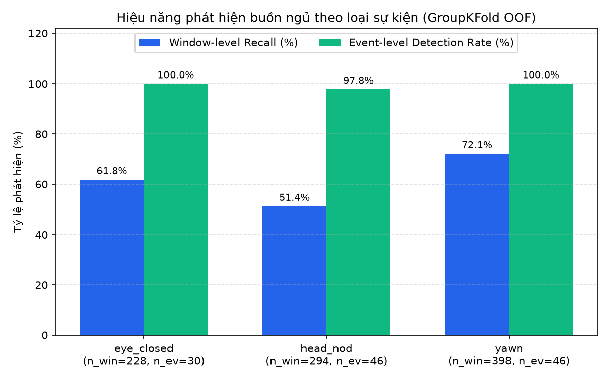

# Huấn luyện, đánh giá, lưu và dự đoán (Random Forest)
| Phụ thuộc | Task 1A (`ai/dataset.py`, `ai/features.py`) đã merge vào `develop` |
| Đầu ra chính | `ai/train.py`, `ai/evaluate.py`, `ai/predict.py`, `tests/test_model.py` |

> **Lưu ý quan trọng:** hiện tại model được huấn luyện trên **dữ liệu giả** do nhóm tự sinh. Kết quả (accuracy, recall, ...) trên dữ liệu giả **chỉ dùng để kiểm tra pipeline chạy đúng**, **không** phải kết quả của hệ thống và **không** đưa vào báo cáo như kết quả thật.

---

## 1. Tổng quan

Task 1A tạo ra dữ liệu và các đặc trưng theo cửa sổ trượt. Task 1B biến chúng thành một model dùng được:

```
Dữ liệu (1A)
   │  chia train/test THEO NGƯỜI
   ▼
TRAIN (Random Forest)  ──►  EVALUATE (đo trên tập test)
   │
   ▼
LƯU "gói" .joblib (model + cấu hình)
   │
   ▼
DrowsinessPredictor nạp gói  ──►  predict(window) ──► (nhãn, xác suất DROWSY)
```

**Quy ước nhãn:** `0 = ALERT` (tỉnh táo), `1 = DROWSY` (buồn ngủ).

**Mục tiêu:** một lệnh ra file model, một lệnh khác nạp model và dự đoán. Khi có dữ liệu thật của A và B, chỉ cần thay nguồn dữ liệu, không phải viết lại code.

---

## 2. Nguyên lý

### 2.1 Bài toán: phân loại có giám sát

Ta có nhiều **cửa sổ** (một đoạn vài chục khung hình liên tiếp). Mỗi cửa sổ được tóm tắt thành một vector đặc trưng (ví dụ EAR trung bình, số lần chớp mắt, ...) và có sẵn nhãn 0/1. Model học quy luật nối đặc trưng với nhãn, rồi dùng quy luật đó để đoán nhãn cho cửa sổ mới.

**Overfitting (học vẹt):** model nhớ luôn dữ liệu train thay vì học quy luật chung, nên điểm train rất cao nhưng điểm trên dữ liệu mới thấp. Vì vậy:

- Luôn **đánh giá trên tập test** mà model chưa từng thấy.
- So sánh điểm train với điểm test. Chênh lệch càng lớn thì overfitting càng nặng.

### 2.2 Random Forest hoạt động ra sao

Random Forest (rừng ngẫu nhiên) gồm **nhiều cây quyết định** cùng bỏ phiếu.

- **Cây quyết định:** một chuỗi câu hỏi đúng/sai để chia dữ liệu dần, ví dụ "EAR trung bình < 0.2?". Một cây đơn rất dễ học vẹt.
- **Bagging:** mỗi cây được huấn luyện trên một mẫu dữ liệu khác nhau, lấy ngẫu nhiên **có hoàn lại** từ tập train.
- **Chọn đặc trưng ngẫu nhiên:** mỗi lần chia nhánh, cây chỉ được xem một tập con đặc trưng. Nhờ vậy các cây khác nhau, không cây nào "độc quyền" một đặc trưng mạnh.
- **Bỏ phiếu:** kết quả cuối là đa số phiếu của các cây. Xác suất DROWSY chính là tỉ lệ cây bỏ phiếu cho DROWSY.

> **Vì sao tốt hơn một cây?** Mỗi cây sai theo một kiểu riêng. Khi gộp nhiều cây khác nhau, các sai lệch bù trừ cho nhau, kết quả ổn định và ít overfit hơn.

Sau khi train, `feature_importances_` cho biết đặc trưng nào đóng góp nhiều nhất vào quyết định (các giá trị cộng lại bằng 1).

### 2.3 Các siêu tham số đã chọn và lý do

Siêu tham số là các "nút vặn" do người làm đặt ra trước khi train (model không tự học chúng).

| Tham số | Giá trị mặc định | Ý nghĩa | Lý do chọn |
|---|---|---|---|
| `n_estimators` | 200 | Số cây trong rừng | Nhiều cây thì ổn định hơn, nhưng chậm hơn. 200 đủ ổn định với dữ liệu nhỏ. |
| `max_depth` | 8 | Độ sâu tối đa mỗi cây | Cây quá sâu dễ học vẹt. Giới hạn độ sâu để giảm overfitting. |
| `min_samples_leaf` | 2 | Số mẫu tối thiểu ở mỗi lá | Không cho cây tạo lá chỉ chứa 1 mẫu, giúp cây "mượt" hơn. |
| `class_weight` | `"balanced"` | Trọng số theo lớp | Buồn ngủ thường ít mẫu hơn tỉnh táo. Lớp hiếm bị phạt nặng hơn khi đoán sai, tránh việc model chỉ đoán "ALERT" cho an toàn. |
| `random_state` | 42 | Hạt giống ngẫu nhiên | Chạy lại ra cùng kết quả, giúp reviewer tái hiện được. |
| `n_jobs` | -1 | Số luồng CPU | Dùng mọi nhân CPU cho nhanh. Không ảnh hưởng kết quả. |

> **Ghi chú:** đây là giá trị khởi điểm hợp lý, **chưa tinh chỉnh**. Việc chỉnh siêu tham số thuộc task sau khi có dữ liệu thật.

### 2.4 Ý nghĩa các chỉ số đánh giá

Ta coi **DROWSY là lớp "dương"**. Confusion matrix 2×2 (theo thứ tự nhãn `[0, 1]`):

```
                 Dự đoán ALERT   Dự đoán DROWSY
Thực tế ALERT  [      TN              FP      ]
Thực tế DROWSY [      FN              TP      ]
```

- **TP:** buồn ngủ thật, báo đúng.
- **FN:** buồn ngủ thật, **bỏ sót** (nguy hiểm nhất).
- **FP:** tỉnh táo nhưng báo nhầm (**báo động giả**).
- **TN:** tỉnh táo, không báo.

| Chỉ số | Công thức | Ý nghĩa |
|---|---|---|
| Accuracy | (TP + TN) / tổng | Tỉ lệ đoán đúng chung. **Dễ gây hiểu nhầm** khi lớp mất cân bằng (đoán toàn "ALERT" vẫn có accuracy cao). |
| Precision | TP / (TP + FP) | Khi hệ thống báo DROWSY, bao nhiêu phần là đúng. Thấp nghĩa là báo động giả nhiều. |
| Recall | TP / (TP + FN) | Trong số người thật sự buồn ngủ, bắt được bao nhiêu phần. Thấp nghĩa là bỏ sót nhiều. |
| F1 | 2·P·R / (P + R) | Trung bình điều hòa của precision và recall, cân bằng cả hai. |

**Ví dụ tính tay:** TN = 50, FP = 10, FN = 5, TP = 35

- Precision = 35 / (35 + 10) = 35/45 ≈ 0.778
- Recall = 35 / (35 + 5) = 35/40 = 0.875
- F1 = 2 × 0.778 × 0.875 / (0.778 + 0.875) ≈ 0.824

**Vì sao recall của lớp DROWSY quan trọng?** Bỏ sót (FN) nghĩa là tài xế đang buồn ngủ mà hệ thống không cảnh báo, hậu quả có thể rất nghiêm trọng. Vì vậy ta ưu tiên recall cao.

**Nhưng báo động giả cũng cần kiểm soát.** Nếu hệ thống kêu liên tục khi người dùng tỉnh táo, họ sẽ thấy phiền và tắt hệ thống đi, lúc đó cũng mất tác dụng. Do đó phải nhìn cả precision và F1, không chỉ riêng recall. Sự đánh đổi này được điều chỉnh bằng **ngưỡng** (xem mục 2.5).

### 2.5 `predict_proba` và ngưỡng

`predict_proba` trả về xác suất của từng lớp thay vì chỉ nhãn. Ta lấy xác suất của DROWSY rồi so với một **ngưỡng** (mặc định 0.5):

- Xác suất ≥ ngưỡng → nhãn 1 (DROWSY)
- Xác suất < ngưỡng → nhãn 0 (ALERT)

Hạ ngưỡng thì bắt được nhiều ca buồn ngủ hơn (recall tăng) nhưng báo động giả cũng tăng. Nâng ngưỡng thì ngược lại.

> **Chú ý kỹ thuật:** cột nào của `predict_proba` ứng với lớp nào được quyết định bởi `model.classes_`. Code tìm đúng cột của lớp 1 thay vì mặc định là cột thứ hai.

### 2.6 Vì sao lưu cả cấu hình cùng model

Chỉ lưu model là **chưa đủ**, vì model không biết gì về cách đưa dữ liệu vào. Gói `.joblib` lưu thêm:

| Thành phần | Vì sao cần |
|---|---|
| `model` | Chính là Random Forest đã train. |
| `feature_names` | Thứ tự và tên các đặc trưng. Đưa sai thứ tự thì model vẫn chạy nhưng **đoán sai mà không báo lỗi**. Còn dùng để kiểm tra số đặc trưng đầu vào. |
| `window_size` | Độ dài cửa sổ lúc train. Lúc dự đoán phải cắt cửa sổ cùng độ dài, nếu không đặc trưng sẽ lệch phân phối. |
| `threshold` | Ngưỡng quyết định nhãn. Lưu cùng model để mọi nơi dùng cùng một ngưỡng và dễ chỉnh sau. |
| `labels` | Ánh xạ `0 → ALERT`, `1 → DROWSY`. |
| `sklearn_version` | Model lưu bằng phiên bản này có thể không nạp đúng ở phiên bản khác. Dùng để cảnh báo khi không khớp. |

Nhờ vậy người dùng chỉ cần file `.joblib` là tái tạo lại đúng cách dự đoán, không phải đoán các thông số.

### 2.7 Chia train/test theo người (tránh rò rỉ dữ liệu)

Các cửa sổ trượt liền kề gần như giống hệt nhau. Nếu cùng một người xuất hiện ở cả train và test, model có thể "nhận ra người đó" thay vì "nhận ra buồn ngủ" và cho điểm test đẹp một cách giả tạo (**data leakage**).

Vì vậy dữ liệu được chia bằng `GroupShuffleSplit` theo mã người: **mỗi người chỉ nằm ở một phía** (train hoặc test).

---

## 3. Cách sử dụng

### 3.1 Chuẩn bị

```bash
git checkout develop
git pull origin develop          # phải có code của 1A
git checkout feature/TASK-0YY-ai-train-predict

pip install scikit-learn joblib numpy pytest
```

### 3.2 Train (ra file model)

```bash
python -m ai.train
```

Tùy chọn:

| Tham số | Mặc định | Ý nghĩa |
|---|---|---|
| `--out` | `ai/model/drowsiness_rf.joblib` | Đường dẫn file model sẽ lưu |
| `--window-size` | `30` | Số khung hình mỗi cửa sổ |
| `--threshold` | `0.5` | Ngưỡng xác suất để gán nhãn DROWSY |

Ví dụ: `python -m ai.train --out ai/model/test.joblib --window-size 30 --threshold 0.4`

Lệnh sẽ in: điểm train/test, báo cáo đánh giá (accuracy, precision, recall, F1, confusion matrix) và đường dẫn file đã lưu.

> **Không commit file `.joblib`** (đã nằm trong `.gitignore`). Việc chia sẻ model thật cho D sẽ bàn khi có dữ liệu thật.

### 3.3 Predict (nạp model và dự đoán)

**Cách 1: dòng lệnh** (truyền sẵn vector đặc trưng, đúng số lượng và thứ tự như `feature_names`):

```bash
python -m ai.predict --model ai/model/drowsiness_rf.joblib --features <giá trị 1>,<giá trị 2>,...
```

Kết quả in nhãn (ALERT/DROWSY) và xác suất DROWSY.

**Cách 2: trong code Python** (cách app của D dùng):

```python
from ai.predict import DrowsinessPredictor

predictor = DrowsinessPredictor("ai/model/drowsiness_rf.joblib")

# window: một cửa sổ khung hình, đúng định dạng mà 1A quy định
label, proba = predictor.predict(window)

print("DROWSY" if label == 1 else "ALERT", f"(xác suất buồn ngủ = {proba:.2f})")
```

Nếu đã có sẵn đặc trưng thì dùng `predictor.predict_features(features)`.

### 3.4 Chạy test

```bash
python -m pytest
```

---

## 4. Giải thích các file code

### `ai/evaluate.py`: đánh giá model

| Thành phần | Việc làm |
|---|---|
| `evaluate_model(model, X_test, y_test)` | Dự đoán trên tập test, trả về dict gồm `accuracy`, `precision`, `recall`, `f1` (của lớp DROWSY), `confusion_matrix` (dạng `[[TN, FP], [FN, TP]]`) và `report` (văn bản từ `classification_report`). |
| `print_report(metrics)` | In kết quả ra màn hình cho dễ đọc. Tách riêng để hàm tính toán không có `print`, dễ test. |

> Dùng `labels=[0, 1]` để confusion matrix luôn là 2×2, và `zero_division=0` để không lỗi khi mẫu số bằng 0.

### `ai/train.py`: huấn luyện và lưu

| Thành phần | Việc làm |
|---|---|
| `DEFAULT_PARAMS` | Bộ siêu tham số mặc định (mục 2.3). |
| `train_model(X_train, y_train, params=None)` | Tạo `RandomForestClassifier` với tham số mặc định (có thể bị `params` ghi đè), huấn luyện và trả về model. |
| `split_by_person(X, y, groups, ...)` | Chia train/test sao cho mỗi người chỉ ở một phía (mục 2.7). |
| `save_bundle(model, feature_names, window_size, threshold, path)` | Đóng gói model + cấu hình (mục 2.6) và lưu bằng `joblib.dump`. Tự tạo thư mục nếu chưa có. |
| `load_windows(window_size)` | Điểm nối với 1A: lấy `X`, `y`, `groups`, `feature_names`. Khi có dữ liệu thật, chỉ cần đổi hàm này. |
| `main()` | Chạy toàn bộ: đọc dữ liệu → chia theo người → train → đánh giá → lưu. |

### `ai/predict.py`: dự đoán

| Thành phần | Việc làm |
|---|---|
| `DrowsinessPredictor(model_path)` | Nạp gói **một lần**. Cảnh báo nếu khác phiên bản sklearn; báo lỗi nếu số đặc trưng trong gói không nhất quán. |
| `predict_features(features)` | Nhận đặc trưng đã tính sẵn, kiểm tra đúng số lượng, trả về `(nhãn, xác suất DROWSY)`. |
| `predict(window)` | Nhận cửa sổ khung hình, gọi `build_window_features` của 1A rồi gọi `predict_features`. |

> **Không** phát cảnh báo trong file này. Việc đếm N lần liên tiếp báo DROWSY mới kêu thuộc `alert/` của D.

### `tests/test_model.py`: kiểm thử tự động

| Test | Kiểm tra |
|---|---|
| `test_predict_returns_valid_types` | Nhãn thuộc {0, 1}, xác suất nằm trong [0, 1]. |
| `test_reload_gives_same_prediction` | Lưu rồi nạp lại, dự đoán phải giống nhau. |
| `test_wrong_feature_count_raises` | Đưa sai số đặc trưng thì báo `ValueError` rõ ràng. |
| `test_evaluate_returns_expected_keys` | Kết quả đánh giá có đủ các chỉ số. |

> Test dùng dữ liệu giả nhỏ và thư mục tạm `tmp_path`, nên chạy nhanh và không để lại file rác. Test chỉ kiểm tra **hình dạng và hành vi** của code, không kiểm tra độ chính xác của model.

pytest 10 passed; một lần chia theo người, Test acc 0.921, DROWSY precision 0.80, recall 0.935, F1 0.862.

---

## 6. Lưu ý và ngoài phạm vi

- Kết quả trên dữ liệu giả **chỉ để kiểm tra pipeline**, không dùng như kết quả hệ thống.
- Không commit file `.joblib`.
- Việc **ngoài phạm vi** task này (làm ở task sau): huấn luyện trên dữ liệu thật của A và B; baseline luật EAR để so sánh; chỉnh ngưỡng và tinh chỉnh siêu tham số; tích hợp vào `controller.py` (D làm); review PR của A.

## Phân tích theo loại sự kiện (`eye_closed`, `head_nod`, `yawn`)

Để kiểm chứng khả năng nhận diện của mô hình trên từng biểu hiện buồn ngủ khác nhau, hệ thống chạy đánh giá Out-of-Fold (`GroupKFold` theo `subject_id`, ngưỡng `threshold = 0.5`) bằng script `ai/analyze_events.py`.

| Loại sự kiện | Số cửa sổ (`n_windows`) | Số sự kiện (`n_events`) | Window Recall | Event Detection Rate | Xác suất TB (`mean_proba`) | EAR TB | MAR TB | PERCLOS TB |
| :--- | :---: | :---: | :---: | :---: | :---: | :---: | :---: | :---: |
| `eye_closed` | 228 | 30 | 61.8% | **100.0%** | 0.567 | 0.183 | 0.012 | 0.585 |
| `head_nod` | 294 | 46 | **51.4%** | **97.8%** | **0.478** | 0.211 | 0.014 | 0.496 |
| `yawn` | 398 | 46 | **72.1%** | **100.0%** | **0.651** | 0.234 | 0.456 | 0.267 |



### Nhận xét & Kiểm chứng giả thuyết `head_nod`

1. **Giả thuyết về `head_nod` được xác nhận rõ ràng:**
   * `head_nod` có **Window-level Recall thấp nhất (51.4%)**, thấp hơn 10.4 điểm phần trăm so với `eye_closed` (61.8%) và thấp hơn 20.7 điểm phần trăm so với `yawn` (72.1%).
   * Xác suất dự đoán trung bình của `head_nod` chỉ đạt **0.478** (dưới ngưỡng phân loại 0.5), đồng thời là loại sự kiện duy nhất không đạt 100% ở mức sự kiện (97.8%, bỏ sót 1/46 sự kiện).
   * **Nguyên nhân kỹ thuật:** Bộ đặc trưng hiện tại chỉ sử dụng thống kê của `EAR`, `MAR` và `PERCLOS`. Trong các cửa sổ `head_nod`, miệng vẫn khép (`mean_mar = 0.014`) và `mean_ear = 0.211` (cao hơn mức `0.183` của `eye_closed` và nằm trên ngưỡng PERCLOS `0.20`), `mean_perclos` chỉ đạt `0.496`. Mô hình chủ yếu nhận diện `head_nod` một cách *gián tiếp* khi người lái đồng thời nhắm mắt hoặc khi đầu cúi xuống làm biến dạng hình chiếu 2D của mắt (perspective foreshortening).

2. **`yawn` đạt hiệu năng cao nhất nhờ tín hiệu `MAR` tách biệt:**
   * Khi ngáp, `mean_mar` tăng vọt lên **0.456** (so với `0.012`–`0.014` ở hai nhóm còn lại), giúp Random Forest phân tách rất rõ rệt (`Window Recall = 72.1%`, `mean_proba = 0.651`, `Event Detection Rate = 100.0%`).

3. **`eye_closed` ổn định và chênh lệch Window-level vs. Event-level:**
   * Với `eye_closed`, `mean_ear` giảm sâu xuống **0.183** và `mean_perclos` tăng lên **0.585**, giúp bắt trọn 30/30 sự kiện (`100.0%`).
   * Tỷ lệ phát hiện ở mức sự kiện (`97.8%–100.0%`) cao hơn hẳn mức cửa sổ (`51.4%–72.1%`) do các cửa sổ rìa (đầu/cuối sự kiện) chỉ chứa một phần hành vi buồn ngủ. Trong vận hành thực tế, chỉ cần bắt trúng ít nhất 1 cửa sổ trong chu kỳ là hệ thống đã kích hoạt được cảnh báo, nhưng Recall mức cửa sổ thấp ở `head_nod` sẽ làm tăng độ trễ cảnh báo.

4. **Hướng cải tiến có cơ sở định lượng:**
   * Tập dữ liệu `train_features.csv` hiện đã trích xuất sẵn các góc tư thế đầu (Head Pose như `yaw`, `roll`, `pitch`). Bổ sung đặc trưng thống kê của góc cúi đầu (`pitch`) và tốc độ biến thiên góc đầu vào `build_window_features` là bước nâng cấp trực tiếp và hiệu quả nhất để cải thiện Recall cho `head_nod`.


---

## Phân tích hiệu năng theo loại sự kiện (`eye_closed`, `head_nod`, `yawn`)

### Mục tiêu & Phương pháp
Để đánh giá sâu hơn điểm mạnh/điểm yếu của mô hình Random Forest ngoài các chỉ số tổng hợp (F1, Precision, Recall), hệ thống thực hiện phân tích lỗi theo từng nhóm hành vi buồn ngủ trong `data/annotations/annotations_train.csv` bằng script `ai/analyze_events.py`.

* **Giao thức đánh giá:** Out-of-Fold (OOF) sử dụng `GroupKFold` chia theo `subject_id` để đảm bảo không rò rỉ dữ liệu giữa tập huấn luyện và tập kiểm thử.
* **Cấu hình cửa sổ:** `window_size = 30`, `stride = 10`, `ear_threshold = 0.20`, ngưỡng phân loại `threshold = 0.50`.
* **Hai mức độ đo lường:**
  * **Window-level Recall:** Tỷ lệ cửa sổ thuộc sự kiện được mô hình dự đoán là buồn ngủ (`label = 1`).
  * **Event-level Detection Rate:** Tỷ lệ sự kiện thực tế được phát hiện thành công ở ít nhất 1 cửa sổ trong suốt thời gian diễn ra sự kiện đó.

### Kết quả thực nghiệm

| Loại sự kiện | Số cửa sổ (`n_windows`) | Số sự kiện (`n_events`) | Window Recall | Event Detection Rate | Xác suất TB (`mean_proba`) | EAR TB | MAR TB | PERCLOS TB |
| :--- | :---: | :---: | :---: | :---: | :---: | :---: | :---: | :---: |
| `eye_closed` | 228 | 30 | 61.8% | **100.0%** | 0.567 | 0.183 | 0.012 | 0.585 |
| `head_nod` | 294 | 46 | **51.4%** | **97.8%** | **0.478** | 0.211 | 0.014 | 0.496 |
| `yawn` | 398 | 46 | **72.1%** | **100.0%** | **0.651** | 0.234 | 0.456 | 0.267 |


### Nhận xét & Kiểm chứng giả thuyết `head_nod`

> [!WARNING]
> **Xác nhận giả thuyết về `head_nod`:** Đây là nhóm hành vi khó nhận diện nhất của mô hình hiện tại với **Window Recall thấp nhất (51.4%)**, xác suất dự đoán trung bình chỉ đạt **0.478** (dưới ngưỡng 0.5) và là nhóm duy nhất bị bỏ sót trọn vẹn một sự kiện (45/46 sự kiện, tương ứng **97.8%**).

1. **Nguyên nhân kỹ thuật ở `head_nod`:**
   * Bộ đặc trưng cửa sổ hiện tại (`9` chiều) chỉ dựa trên thống kê của `EAR`, `MAR` và `PERCLOS`.
   * Trong các cửa sổ `head_nod`, miệng vẫn khép (`MAR TB = 0.014`), `EAR TB = 0.211` (cao hơn mức `0.183` của `eye_closed` và nằm trên ngưỡng `0.20`), `PERCLOS TB = 0.496`.
   * Do không có đặc trưng tư thế đầu, mô hình chỉ phát hiện `head_nod` một cách *gián tiếp* khi người lái đồng thời nhắm mắt hoặc khi góc cúi đầu làm biến dạng phép chiếu 2D của vùng mắt (perspective foreshortening).
2. **`yawn` đạt hiệu năng cao nhất:**
   * Hành vi ngáp tạo ra tín hiệu tách biệt rất mạnh trên trục `MAR` (`MAR TB = 0.456`, cao gấp hơn 30 lần so với `0.012`–`0.014` ở hai nhóm còn lại), giúp mô hình đạt **Window Recall 72.1%**, `mean_proba = 0.651` và bắt trọn **100.0%** (46/46) sự kiện.
3. **`eye_closed` ổn định và ý nghĩa của Event-level Detection Rate:**
   * Nhóm `eye_closed` có `EAR TB = 0.183` thấp nhất và `PERCLOS TB = 0.585` cao nhất, đạt **100.0%** (30/30) tỷ lệ phát hiện ở mức sự kiện.
   * Tỷ lệ phát hiện mức sự kiện (`97.8%`–`100.0%`) cao hơn rõ rệt so với mức cửa sổ (`51.4%`–`72.1%`) vì các cửa sổ ở rìa (đầu/cuối) chỉ chứa một phần nhỏ hành vi buồn ngủ. Tuy vậy, Window Recall thấp ở `head_nod` đồng nghĩa độ trễ cảnh báo trên nhóm hành vi này sẽ lớn hơn.
4. **Hướng cải tiến có cơ sở định lượng:**
   * Tập dữ liệu `train_features.csv` đã lưu sẵn các góc đầu (`yaw`, `roll`, ...). Bổ sung thống kê góc cúi đầu (`pitch`) và tốc độ thay đổi góc đầu vào `build_window_features` là hướng nâng cấp trực tiếp để tăng Window Recall cho `head_nod`.
